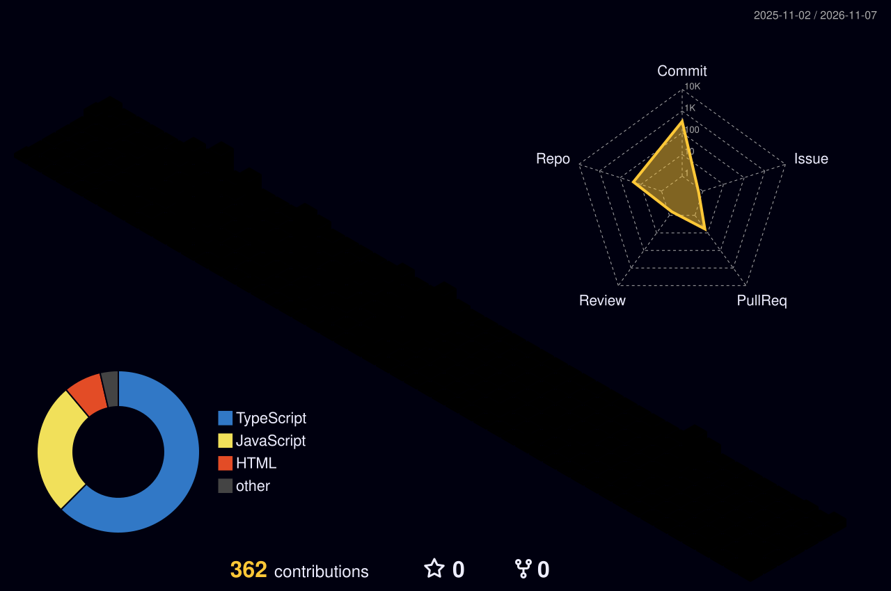

<!-- 🌊 Animated Waving Header -->

  

<!-- ⌨️ Animated Typing SVG -->

  

  
  

---

## 🚀 About Me

- 💻 **Full-Stack Developer** passionate about architecting scalable web applications, real-time systems, and clean UIs.
- 🌍 Active **Open Source Contributor** with merged PRs across community-driven repositories.
- 🧠 Consistently practicing **Data Structures & Algorithms (DSA)** in **C++** and **TypeScript/JavaScript**.
- ⚡ Exploring system design, containerized workflows with **Docker**, and high-performance backend architectures.

---

## 🛠️ 3D Tech Stack & Tools

  <h4>Languages & Core Technologies</h4>
  
    
  <h4>Frameworks, Databases & DevOps</h4>
  

---

## 🏆 GitHub Trophies

  

---

## 📊 GitHub Analytics

  
  

  

<!-- 📈 Contribution Activity Graph -->

  

---

## 🧊 3D Isometric Contribution Calendar

  <picture>
    <source media="(prefers-color-scheme: dark)" srcset="https://raw.githubusercontent.com/shivam108ku/shivam108ku/main/profile-3d-contrib/profile-night-rainbow.svg" />
    <source media="(prefers-color-scheme: light)" srcset="https://raw.githubusercontent.com/shivam108ku/shivam108ku/main/profile-3d-contrib/profile-gitblock.svg" />
    
  </picture>

---

## 🐍 Contribution Grid Snake

  <picture>
    <source media="(prefers-color-scheme: dark)" srcset="https://raw.githubusercontent.com/shivam108ku/shivam108ku/output/github-snake-dark.svg" />
    <source media="(prefers-color-scheme: light)" srcset="https://raw.githubusercontent.com/shivam108ku/shivam108ku/output/github-snake.svg" />
    
  </picture>

<!-- 🌊 Animated Waving Footer -->

  

